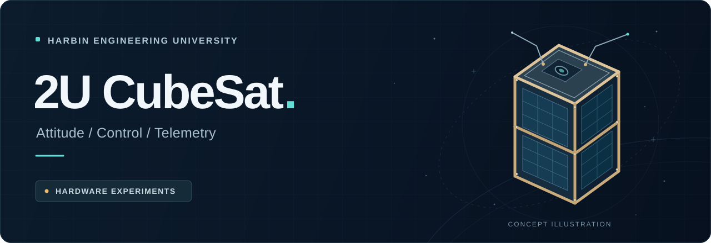
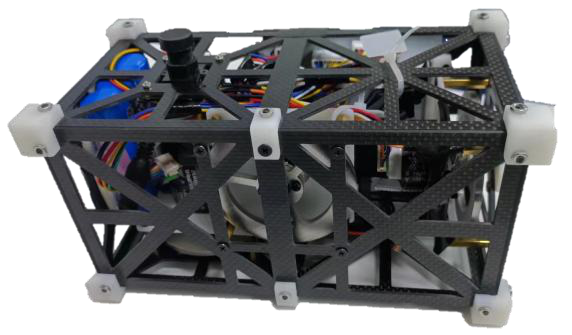
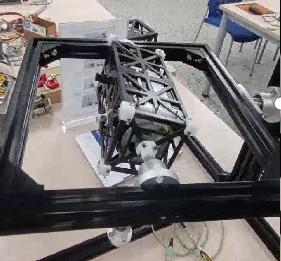
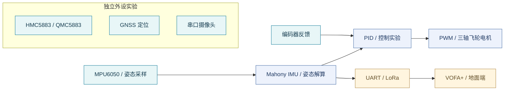

# 2U CubeSat · 立方星设计与实验

<p align="center">
  
</p>

<p align="center">
  <strong>从结构设计到姿态控制，探索一颗立方星的系统协作。</strong><br>
  哈尔滨工程大学 · Beyond GO BE 小组 · 2U 立方星地面实验项目
</p>

<p align="center">
  
</p>

<p align="center">
  <strong>简体中文</strong> · <a href="docs/README.en.md">English</a><br>
  <a href="#项目概览">项目概览</a> · <a href="#实物与实验">实物与实验</a> · <a href="#模块导航">模块导航</a> · <a href="docs/getting-started.md">上手指南</a> · <a href="docs/source-map.md">源码索引</a>
</p>

---

## 项目概览

本项目围绕 **2U 立方星的结构设计、姿态测量、飞轮控制与无线遥测**展开地面实验，保留了 CH32V307 平台的 C 源码、传感器驱动、多个实验入口，以及完整的设计报告。

设计报告以姿态自稳定、目标扫描和目标跟踪为任务目标，覆盖 SolidWorks 结构建模、应力与热分析、硬件与电路设计、控制算法和实验记录。仓库中的代码可用于理解各模块的实现与集成思路。

> **当前资料状态：**本仓库是源码与设计资料快照，尚未包含完整 SDK、启动文件、链接脚本及 IDE 工程配置。各实验文件独立保留；复现前请先阅读[上手与工程集成](docs/getting-started.md)。

| 方向 | 主要内容 |
| --- | --- |
| **姿态感知** | MPU6050 数据采集、Mahony IMU 姿态解算，以及 HMC5883 / QMC5883 独立磁力计实验 |
| **飞轮控制** | 三轴电机、编码器反馈、PWM 输出与不同版本的 PID 控制实验 |
| **通信与载荷** | LoRa 串口通信、VOFA+ 数据输出、GNSS 定位与串口摄像头实验 |
| **结构与验证** | 设计报告中的结构建模、仿真分析、实物装配和测控实验记录 |

## 实物与实验

<table>
  <tr>
    <td align="center" width="50%">
      <br>
      <strong>立方星装配实物</strong><br>
      <sub>设计报告第 11 页 · 图 20</sub>
    </td>
    <td align="center" width="50%">
      <br>
      <strong>扰动恢复测试装置</strong><br>
      <sub>设计报告第 25 页 · 图 57</sub>
    </td>
  </tr>
</table>

图片直接提取自仓库原有设计报告；顶部封面为概念插图。图片来源和提取位置见[素材说明](docs/assets/README.md)。

## 系统组成

下图概括项目的模块关系；不同模块分布在独立实验版本中，不表示所有模块已在同一固件中集成。



## 模块导航

| 从这里开始 | 对应文件 | 说明 |
| --- | --- | --- |
| 主控制流程 | [`main.c`](main.c) | 姿态采样、控制函数、编码器与遥测 |
| 控制方案对照 | [`main_newpid.c`](main_newpid.c) · [`main_teacher.c`](main_teacher.c) · [`main_teacher2.c`](main_teacher2.c) | 不同控制与参数实验版本 |
| 姿态算法 | [`MahonyAHRS.c`](MahonyAHRS.c) · [`MahonyAHRS.h`](MahonyAHRS.h) | 四元数与 AHRS / IMU 更新接口 |
| 磁力计测试 | [`main_HMC5883test.c`](main_HMC5883test.c) · [`main_QMC5883test.c`](main_QMC5883test.c) | 两类磁力计的独立验证入口 |
| 无线遥测 | [`main_loraTEST.c`](main_loraTEST.c) · [`Vofa.h`](Vofa.h) | LoRa 串口数据与 VOFA JustFloat 格式 |
| 定位与图像 | [`GPS.c`](GPS.c) · [`main_lora_and_camera.c`](main_lora_and_camera.c) | GNSS 解析及摄像头通信实验 |
| 扫描实验 | [`scan.c`](scan.c) · [`scan2.c`](scan2.c) | 串口触发的扫描与电机控制逻辑 |
| 中断与外设驱动 | [`isr.c`](isr.c) · [`hmc5883.c`](hmc5883.c) · [`qmc5883.c`](qmc5883.c) | 中断回调、软件 I²C 与传感器接口 |

查看[完整源码索引](docs/source-map.md)，了解全部 C / H 文件及推荐阅读顺序。

## 开始阅读与复现

```bash
git clone https://github.com/SJiale/2U-CubeSat.git
cd 2U-CubeSat
```

1. **读设计报告**：先了解结构、硬件连接与实验目标。
2. **选一个入口**：仓库有 11 个包含 `main()` 的实验文件，每个构建目标只选择一个。
3. **补齐工程环境**：准备匹配开发板的逐飞库 / 芯片 SDK，并配置工具链、启动文件和链接脚本。
4. **逐模块验证**：先检查传感器和串口，再核对算法周期、引脚复用、编码器与电机参数。

详细环境信息、接口差异与集成步骤见[上手指南](docs/getting-started.md)。历史 C / H 文件保留原始编码；中文注释乱码时，可尝试以 GBK / GB18030 打开。

## 设计报告

**[阅读完整设计报告 · PDF · 34 页](Beyond%20GO%20BE%E7%BB%84%20%E7%AB%8B%E6%96%B9%E6%98%9F%E8%AE%BE%E8%AE%A1%E6%8A%A5%E5%91%8A.pdf)**

| 阅读主题 | 报告位置 |
| --- | --- |
| 背景、任务与设计要求 | 第 1–4 页 |
| 结构建模与仿真分析 | 第 4–11 页 |
| 传感器、通信与执行机构 | 第 11–16 页 |
| 电路设计与地面端界面 | 第 17–19 页 |
| 姿态控制、软件设计与实验 | 第 19–25 页 |

报告中的结构模型、PCB 和地面端界面可供阅读参考；仓库目前未附相应 CAD、PCB 工程或地面端工程文件。

## 交流与贡献

欢迎通过 [Issues](https://github.com/SJiale/2U-CubeSat/issues) 反馈文档问题、记录复现实验或提出改进建议。提交代码前，请说明所使用的实验入口、硬件、SDK 与验证结果，详见[贡献说明](CONTRIBUTING.md)。

## 许可与致谢

根目录 [`LICENSE`](LICENSE) 采用 MIT 许可；部分源码保留各自的第三方声明，例如 `isr.c` / `isr.h` 中的 SEEKFREE GPL 声明，以及 Mahony 算法文件中的原作者信息。复用时请查看并保留对应文件的声明。

感谢项目小组成员的设计与实验工作，以及逐飞科技库、Mahony 姿态算法等基础工具与实现。
