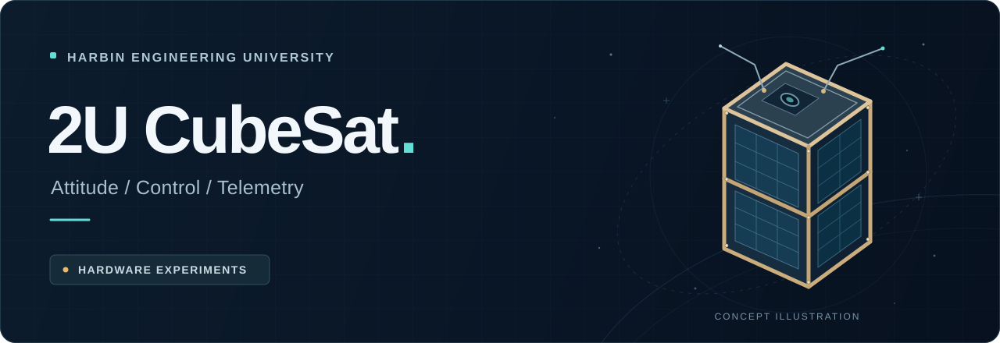
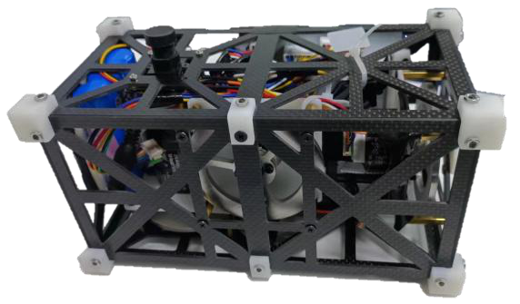
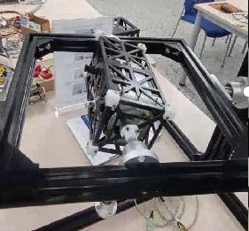
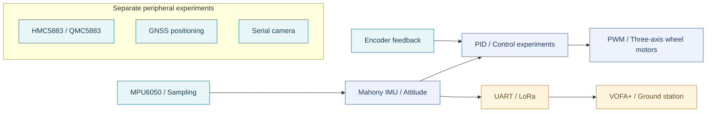

# 2U CubeSat · Design & Experiments

<p align="center">
  
</p>

<p align="center">
  <strong>Exploring how a CubeSat's systems work together, from structure to attitude control.</strong><br>
  Harbin Engineering University · Beyond GO BE team · 2U CubeSat ground experiments
</p>

<p align="center">
  
</p>

<p align="center">
  <a href="../README.md">简体中文</a> · <strong>English</strong><br>
  <a href="#overview">Overview</a> · <a href="#prototype--experiments">Prototype</a> · <a href="#code-navigation">Code navigation</a> · <a href="getting-started.md">Getting started (Chinese)</a> · <a href="source-map.md">Source map (Chinese)</a>
</p>

---

## Overview

This project explores **2U CubeSat structural design, attitude estimation, reaction-wheel control and wireless telemetry** through ground experiments. The repository preserves C source files for the CH32V307 platform, sensor drivers, multiple experimental entry points and the full design report.

The report sets out attitude self-stabilization, target scanning and target tracking as mission objectives. It covers SolidWorks structural modeling, stress and thermal analysis, hardware and circuit design, control algorithms and experimental records. The source files illustrate individual modules and their integration approaches.

> **Repository status:** This is a snapshot of source code and design materials. The complete SDK, startup files, linker scripts and IDE project configuration are not included. Experimental variants remain separate; read the [integration guide (Chinese)](getting-started.md) before attempting reproduction.

| Area | Contents |
| --- | --- |
| **Attitude sensing** | MPU6050 acquisition, Mahony IMU attitude estimation and separate HMC5883 / QMC5883 magnetometer experiments |
| **Reaction-wheel control** | Three-axis motors, encoder feedback, PWM output and several PID control variants |
| **Communications & payloads** | LoRa serial communication, VOFA+ output, GNSS positioning and serial camera experiments |
| **Structure & validation** | Structural modeling, simulation, prototype assembly and measurement/control experiments documented in the report |

## Prototype & experiments

<table>
  <tr>
    <td align="center" width="50%">
      <br>
      <strong>Assembled CubeSat prototype</strong><br>
      <sub>Design report · page 11 · Figure 20</sub>
    </td>
    <td align="center" width="50%">
      <br>
      <strong>Disturbance recovery test rig</strong><br>
      <sub>Design report · page 25 · Figure 57</sub>
    </td>
  </tr>
</table>

The photographs were extracted directly from the original design report. The banner is a concept illustration. See [asset provenance (Chinese)](assets/README.md) for sources and extraction locations.

## System overview

This diagram summarizes module relationships across separate experiments; it does not indicate that every module is integrated into one firmware image.



## Code navigation

| Start here | Files | Focus |
| --- | --- | --- |
| Main control flow | [`main.c`](../main.c) | Attitude sampling, control functions, encoders and telemetry |
| Control variants | [`main_newpid.c`](../main_newpid.c) · [`main_teacher.c`](../main_teacher.c) · [`main_teacher2.c`](../main_teacher2.c) | Alternative control and parameter experiments |
| Attitude algorithm | [`MahonyAHRS.c`](../MahonyAHRS.c) · [`MahonyAHRS.h`](../MahonyAHRS.h) | Quaternion state and AHRS / IMU update interfaces |
| Magnetometer tests | [`main_HMC5883test.c`](../main_HMC5883test.c) · [`main_QMC5883test.c`](../main_QMC5883test.c) | Independent test entry points for two magnetometers |
| Wireless telemetry | [`main_loraTEST.c`](../main_loraTEST.c) · [`Vofa.h`](../Vofa.h) | LoRa serial data and VOFA JustFloat format |
| Positioning & imaging | [`GPS.c`](../GPS.c) · [`main_lora_and_camera.c`](../main_lora_and_camera.c) | GNSS parsing and camera communication experiments |
| Scanning experiments | [`scan.c`](../scan.c) · [`scan2.c`](../scan2.c) | Serial-triggered scanning and motor control |
| Interrupts & drivers | [`isr.c`](../isr.c) · [`hmc5883.c`](../hmc5883.c) · [`qmc5883.c`](../qmc5883.c) | Interrupt callbacks, software I²C and sensor interfaces |

The [complete source map (Chinese)](source-map.md) indexes every C / H file and suggests a reading order.

## Getting started

```bash
git clone https://github.com/SJiale/2U-CubeSat.git
cd 2U-CubeSat
```

1. **Read the design report** for the structure, hardware connections and experiment objectives.
2. **Choose one entry point.** There are 11 files containing `main()`; select only one per build target.
3. **Complete the project environment.** Supply a matching SEEKFREE library / chip SDK, toolchain, startup files and linker script.
4. **Validate modules progressively.** Check sensors and serial links, then verify algorithm timing, pin assignments, encoders and motor parameters.

See the [integration guide (Chinese)](getting-started.md) for environment details and differences between variants. Historical C / H files retain their original encoding; try GBK / GB18030 if Chinese comments appear garbled.

## Design report

**[Read the full design report · PDF · 34 pages · Chinese](../Beyond%20GO%20BE%E7%BB%84%20%E7%AB%8B%E6%96%B9%E6%98%9F%E8%AE%BE%E8%AE%A1%E6%8A%A5%E5%91%8A.pdf)**

| Topic | Report pages |
| --- | --- |
| Background, objectives and requirements | 1–4 |
| Structural modeling and simulation | 4–11 |
| Sensors, communications and actuators | 11–16 |
| Circuit design and ground station interface | 17–19 |
| Attitude control, software and experiments | 19–25 |

Structural models, PCB designs and the ground station interface are documented in the report. Their corresponding CAD, PCB and ground station project files are not included in this repository.

## Discussion & contributions

Use [Issues](https://github.com/SJiale/2U-CubeSat/issues) to report documentation problems, record reproduction attempts or suggest improvements. For code contributions, describe the entry point, hardware, SDK and validation results; see the [contribution guide (Chinese)](../CONTRIBUTING.md).

## License & acknowledgments

The root [`LICENSE`](../LICENSE) is MIT. Some source files retain separate third-party notices, including SEEKFREE GPL notices in `isr.c` / `isr.h` and original author information in the Mahony algorithm files. Review and preserve the applicable notices when reusing individual files.

Thanks to the project team for its design and experimental work, and to the SEEKFREE library, Mahony attitude algorithm and other underlying tools and implementations.
